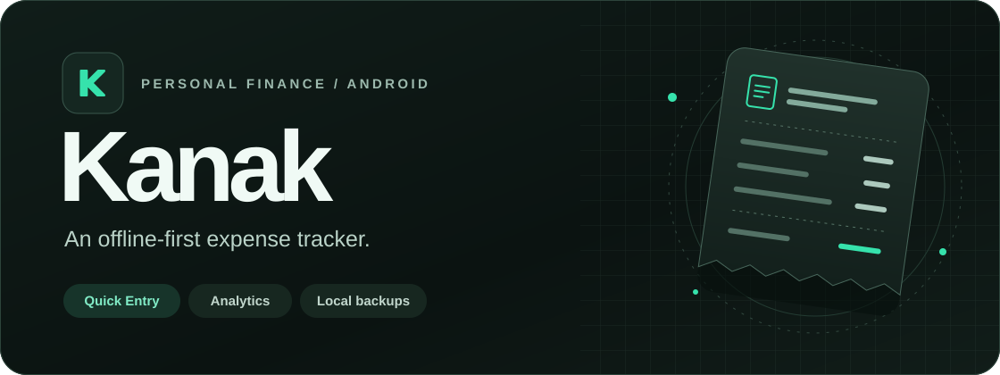
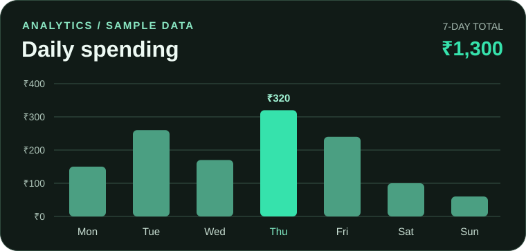
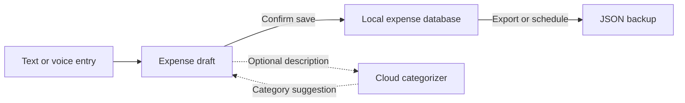

<p align="center">
  
</p>

<h1 align="center">Kanak</h1>

<p align="center">
  Log expenses by text or voice, see where your money goes, and keep a backup you can restore.
</p>

<p align="center">
  <strong><a href="https://github.com/sathwikcherott/kanak-app/releases/latest">↓ Download APK</a></strong>
  &nbsp;·&nbsp; <a href="#features">Explore features</a>
  &nbsp;·&nbsp; <a href="#build-from-source">Build from source</a>
</p>

<p align="center">
  <kbd>Android 15+</kbd> &nbsp; <kbd>Kotlin</kbd> &nbsp; <kbd>Jetpack Compose</kbd> &nbsp; <kbd>Room</kbd>
</p>

## Features

| | What you can do |
| --- | --- |
| ✎ **Quick Entry** | Type or speak an expense, backdate it, or enter arithmetic such as `25 + 50` in builds with math entry. |
| ◈ **Categories** | Group purchases by category. Newer builds add custom categories and separate Tech and Games categories. |
| ▥ **Spending analytics** | Review daily spending, recent transactions, and category breakdowns. |
| ↻ **Backup and restore** | Export a local JSON backup and review a preview before restoring it. Automatic backups on the newer branch keep the three most recent scheduled copies. |
| ✦ **Optional AI suggestions** | A configured cloud connection can suggest a built-in category when local rules find no match. You can still enter and save expenses offline. |

## A look at analytics

<p align="center">
  
</p>

*Illustration with sample data. See your own spending by day and category in the app.*

## Backups and privacy

Kanak stores expenses on your device. In builds with automatic backups, choose a writable folder and schedule **daily**, **Monday/Wednesday/Friday**, **weekly**, or **monthly** copies. Rotation applies to automatic backups in that folder. Manual exports remain separate.

JSON backups are unencrypted. Restoring replaces current expense records after you confirm the preview. Cloud category suggestions require a configured endpoint and send description text for categorization. See the [backup and restore guide](docs/backup-restore.md) for details.



## Install on Android

Open [Releases](https://github.com/sathwikcherott/kanak-app/releases/latest), download the **APK** under **Assets**, and open it on a device running **Android 15 or newer**.

> The latest published APK and the GitHub source archives have separate histories. The release tag points to an older source snapshot. For the source with automatic backups, custom categories, and the mint launcher icon and splash screen, use [`codex/auto-backup`](https://github.com/sathwikcherott/kanak-app/tree/codex/auto-backup).

## Build from source

Use **JDK 21** and install **Android SDK Platform 37.0** in Android Studio. Open the cloned repository and run the `app` configuration on an Android 15+ device or emulator.

```bash
git clone --branch codex/auto-backup https://github.com/sathwikcherott/kanak-app.git
cd kanak-app
./gradlew testDebugUnitTest assembleDebug
```

The debug APK is generated at `app/build/outputs/apk/debug/app-debug.apk`. The repository's [Android checks](https://github.com/sathwikcherott/kanak-app/actions/workflows/android.yml) also cover backup and restore on an emulator.

Found a bug? [Open an issue](https://github.com/sathwikcherott/kanak-app/issues/new) with the app version, Android version, and steps to reproduce it.
